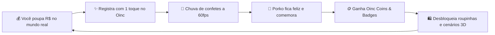

# 🐷 Oinc: Meu cofrinho virtual — Guia Oficial do Produto & Publicação

> *"Transforme o hábito de poupar dinheiro em um jogo leve, gostoso e sem culpa."*  
> **Criado e arquitetado por Mateus Neri ([@mateusnriy](https://github.com/mateusnriy))**

---

## 🧭 1. O Manifesto: Por que o Oinc Existe?

Seja sincero: **quantas vezes você já tentou juntar dinheiro e desistiu no meio do caminho?**

Guardar dinheiro costuma ser chato, solitário e punitivo. No momento em que você decide não gastar R$ 50 hoje para guardar para o futuro, seu cérebro sente apenas a perda imediata (*delay discounting*). A meta parece distante demais, os aplicativos tradicionais exigem cadastros longos, senhas de banco ou ficam te julgando com gráficos vermelhos quando as coisas saem do planejado.

O **Oinc: Meu cofrinho virtual** nasceu para quebrar esse ciclo.

A proposta é simples, acolhedora e direta: **você cuida do seu dinheiro de verdade na vida real enquanto cuida do seu mascote Porko e do seu habitat virtual no aplicativo**.



Esse **duplo loop de recompensa** traz a gratificação para o presente: poupar deixa de ser uma renúncia dolorosa e se torna um motivo diário de celebração.

---

## 🧠 2. A Psicologia do Jogo: Gamificação Anti-Culpa

Diferente de jogos que usam o medo da perda para forçar o usuário a abrir o app (*"seu mascote vai morrer se você não voltar!"*), o Oinc aposta na **psicologia positiva e nos micro-hábitos sustentáveis**:

1. **Piso de Bem-Estar de 40% (Sem Punições Frustrantes):**  
   Mesmo se você passar semanas sem guardar dinheiro ou sem abrir o app, a Felicidade e a Energia do Porko **nunca caem abaixo de 40%**. Ele nunca morre, nunca foge e não te faz sentir mal. Quando você voltar, ele estará lá pronto para recomeçar.
2. **Liberdade de Ritmo (Metas com ou sem Prazo):**  
   Nem todo sonho tem data de validade. Se você quer comprar um videogame até o Natal, o app calcula as parcelas diárias, semanais e mensais. Mas se você quer apenas construir uma reserva sem ansiedade, basta escolher o modo **"🌱 No meu ritmo (Sem prazo)"** e guardar quando e quanto puder.
3. **Privacidade Absoluta = Tranquilidade Mental:**  
   O Oinc é **100% offline**. Nada de criar login, nada de colocar CPF, nada de conectar sua conta bancária. Seus dados moram exclusivamente no seu bolso (dentro do banco de dados local do seu aparelho).

---

## 🌟 3. O Universo do Oinc por Dentro

### 🏞️ O Habitat Vivo & O Mascote Porko em Soft 3D
- **Estética Claymorphism (Soft 3D):** Modelado proceduralmente em código Flutter com 9 camadas de volume, luzes suaves e sombras táteis. O Porko respira, pisca naturalmente e caminha pelo cenário.
- **Ciclo Dia e Noite Integrado:** O céu se adapta ao tema. Durante o dia, sol vibrante e colinas verdes; à noite, céu estrelado, lua e uma caminha quentinha para o Porko dormir.
- **Decorações Interativas:** Conforme você joga, pode mobiliar o habitat com *Vasos de Flores*, *Bandeirinhas de Festa*, *Arco-íris Mágico* e *Estrelas Cadentes*.

### 🎯 Criação de Metas Descomplicada (3 Passos)
- **Passo 1 — O Sonho:** Nome, escolha entre 8 ícones temáticos (viagem, carro, casa, estudos, etc.), 6 cores vivas, valor-alvo e prazo (com botões de atalho ou opção sem prazo).
- **Passo 2 — O Plano:** Comparador em tempo real de parcelas (Diário, Semanal, Mensal ou Livre) e ativação de lembrete diário local.
- **Passo 3 — Validação com o Porko:** O mascote faz um joinha em 3D e valida o plano com você antes de salvar.

### 🗺️ A Jornada de Marcos (Milestones)
Dividimos qualquer objetivo grande em 4 checkpoints para manter a motivação acesa:
- **🥉 25% da Meta:** Primeira conquista! Bônus de **+25 Oinc Coins**.
- **🥈 50% da Meta:** Metade do caminho percorrido! Bônus de **+50 Oinc Coins**.
- **🥇 75% da Meta:** A reta final se aproxima! Bônus de **+75 Oinc Coins**.
- **🏆 100% da Meta (Meta Batida!):** Grande celebração com confetes dourados, badge exclusivo e **+150 Oinc Coins**!

### 🐾 Cantinho do Mascote (Afeto Diário)
Um espaço dedicado ao cuidado do seu companheiro de finanças:
- **Fazer carinho (3x/dia):** Aumenta a felicidade e rende coraçõezinhos táteis.
- **Alimentar (2x/dia):** Dá uma maçãzinha e recupera a energia do Porko.
- **Brincar (2x/dia):** Dá um pulinho alegre e toca sons lúdicos.
- **Chamar (3x/dia):** O Porko responde com um oinc animado na tela.

### 🛍️ Porko Store (Zero Dinheiro Real)
Todas as moedas do jogo são conquistadas guardando dinheiro na vida real. Você pode vestir seu Porko com:
- **Peles:** Clássica, Porquinho de Ouro, Porco de Neve, Chocolate e Azul Bebê;
- **Chapéus:** Boné estiloso, Coroa real, Chapéu de Mago e Óculos de Sol;
- **Roupas:** Gravatinha executiva, Cachecol quentinho e Capa de super-herói;
- **Cenários:** Decorações que mudam o visual do topo da sua tela inicial.

---

## 📱 4. Ficha de Publicação para Lojas (Google Play & App Store)

### 🏷️ Identidade Oficial do Aplicativo

| Atributo | Definição Oficial |
| :--- | :--- |
| **Nome do App** | **Oinc: Meu cofrinho virtual** |
| **Nome Curto (Launcher / Ícone)** | **Oinc** |
| **Subtítulo / Tagline** | *Poupe dinheiro, cuide do seu cofrinho virtual e alcance suas metas!* |
| **Categoria Primária** | Finanças Pessoais / Produtividade |
| **Categoria Secundária** | Estilo de Vida / Jogos Casuais |
| **Classificação Indicativa** | Livre para todos os públicos |
| **Preço & Monetização** | 100% Gratuito • Zero Anúncios • Sem Compras no App |

---

### 📝 Textos Prontos para a Loja

#### 🔹 Descrição Curta (Até 80 caracteres)
> *Poupe dinheiro, cuide do seu cofrinho virtual e alcance suas metas se divertindo!*

#### 🔹 Descrição Longa Completa (Store Listing Formatada)

```markdown
Quer juntar dinheiro para uma viagem, comprar seu novo celular ou montar sua reserva de emergência, mas sempre perde o foco no meio do caminho?

Conheça o Oinc: Meu cofrinho virtual — o aplicativo que transforma o ato de economizar dinheiro em uma jornada leve, bonita e divertida! 🐷✨

Ao contrário de planilhas frias ou apps cheios de anúncios e pedidos de dados bancários, o Oinc coloca você e a sua privacidade no centro de tudo. Aqui, você guarda dinheiro de verdade no seu dia a dia enquanto cuida do seu mascote Porko no aplicativo!

🌟 POR QUE VOCÊ VAI AMAR O OINC:

🎯 METAS CLARAS NO SEU RITMO
Crie seus objetivos em 3 passos simples! Defina o valor e escolha se prefere ter um prazo final (o app calcula quanto guardar por dia, semana ou mês) ou se quer guardar no modo "🌱 No meu ritmo", sem pressão de calendário.

🐷 CUIDE DO SEU MASCOTE PORKO EM 3D
Conheça o Porko, seu companheiro de economia em Soft 3D Claymorphism! Faça carinho, alimente e veja ele comemorar suas conquistas financeiras com reações adoráveis.

🪙 GANHE OINC COINS E PERSONALIZE
Cada real economizado no mundo real te rende Oinc Coins no jogo! Use suas moedas na Porko Store para desbloquear chapéus, gravatas, coroas, óculos e até a lendária Skin do Porquinho de Ouro. Zero dinheiro real gasto aqui: sua consistência é sua única moeda!

🏆 COMEMORE CADA PASSO
Metas grandes não precisam ser assustadoras! O Oinc quebra seus objetivos em marcos interativos de 25%, 50%, 75% e 100%, com direito a chuva de confetes a 60fps e medalhas colecionáveis.

🔥 STREAKS DIÁRIOS E LEMBRETES AMIGÁVEIS
Crie um hábito sólido mantendo sequências de economia ativas e receba lembretes locais gentis no horário que você escolher.

🔒 100% OFFLINE, PRIVADO E SEGURO
• Seus dados pertencem apenas a você e nunca saem do seu celular.
• Sem necessidade de login ou cadastro.
• Nenhuma conexão com contas bancárias.
• Zero anúncios invasivos.
• Modo Privacidade para ocultar seus saldos com um toque.

Baixe o Oinc agora mesmo e descubra como poupar dinheiro pode ser leve, prazeroso e recompensador! 🐷🚀
```

#### 🔹 Palavras-chave / Tags para Otimização de Busca (ASO)
`oinc, cofrinho virtual, cofrinho, cofrinho digital, poupança, metas financeiras, gamificação, educação financeira, economizar dinheiro, finanças pessoais, offline, mascote virtual, tamagotchi financeiro, hábitos, reserva de emergência`

---

## 🛡️ 5. Compromisso de Privacidade & Código Aberto

- **Armazenamento 100% Local:** Todo o aplicativo roda com o motor NoSQL Hive integrado localmente no aparelho. Não há servidores remotos de telemetria, cookies ou analytics invasivos.
- **Backup Descomplicado:** Você pode gerar um relatório seguro de todas as suas metas e depósitos em formato JSON offline com um clique no seu perfil.
- **Código Aberto sob Licença MIT:** Desenvolvido com transparência e paixão por engenharia de software bem feita.
