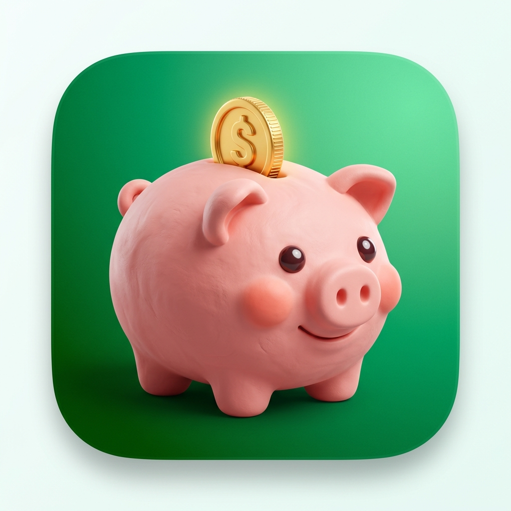

<p align="center">
  
</p>

<h1 align="center">🐷 Oinc: Meu cofrinho virtual</h1>

<p align="center">
  <strong>Transforme o hábito de poupar dinheiro em uma jornada divertida, visual e sem complicação.</strong>
</p>

<p align="center">
  
  
  
  
  
  
  
</p>

<p align="center">
  📖 <strong><a href="APP-OVERVIEW.md">Clique aqui para ler o Guia Oficial do Produto e Publicação (APP-OVERVIEW.md)</a></strong>
</p>

---

## 📋 Sobre o Projeto

O **Oinc: Meu cofrinho virtual** é um aplicativo móvel gratuito e **100% offline-first** focado em educação financeira prática e gamificação comportamental. Desenvolvido em Flutter, o aplicativo resolve o desafio comum da procrastinação financeira ao criar um **duplo loop de recompensa**: o usuário poupa dinheiro na vida real enquanto cuida, alimenta e personaliza o seu cofrinho virtual com o mascote **Porko**.

A cada economia registrada no mundo real, o usuário ganha **Oinc Coins** para adquirir cosméticos exclusivos na loja in-app (Porko Store), desbloqueia badges de conquistas, avança em mapas de marcos (*milestones*) e mantém sequências diárias (*streaks*).

Tudo isso com **privacidade absoluta**: sem logins, sem conexão bancária, sem coleta de dados e sem anúncios invasivos. Seus dados nunca saem do seu smartphone.

---

## 🎯 O Que o Aplicativo Resolve?

1. **Elimina a sensação de privação:** Poupar deixa de ser um sacrifício distante e passa a gerar gratificação imediata com confetes, celebrações a 60fps e evolução no jogo.
2. **Descomplica o planejamento financeiro:** Calcula em tempo real quanto você precisa guardar por dia, por semana ou por mês para bater sua meta dentro do prazo.
3. **Reforço de consistência diária:** Notificações locais e streaks incentivam a criação de hábitos saudáveis sem depender de internet.
4. **Segurança total:** Não solicita senhas bancárias, extratos nem CPF.

---

## ✨ Funcionalidades Principais

### 🎯 Gestão Inteligente de Metas
- **Criação em 2 telas:** Defina nome, ícone representativo, cor, valor-alvo e prazo final.
- **Projeção de economia automatizada:** Sugestão matemática de aportes em modos Diário, Semanal e Mensal.
- **Lembretes locais diários:** Notificações programáveis para incentivar a consistência.

### 💰 Depósitos Ágeis & Histórico
- **Atalhos rápidos com 1 toque:** Botões pré-definidos de R$ 10, R$ 25, R$ 50, R$ 100 e R$ 200 ou digitação manual.
- **Histórico detalhado:** Lista completa de lançamentos com data, valor e notas.
- **Gráficos mensais:** Visualização analítica da evolução dos depósitos mês a mês via `fl_chart`.

### 📊 Dashboard de Patrimônio
- **Visão consolidada:** Total guardado em todas as metas e percentual global de conclusão.
- **Filtros dinâmicos:** Ordenação de metas por data de criação, prazo mais próximo ou maior progresso.

### 🎮 Motor de Gamificação Completo
- **Trilha de Marcos (Milestones):** Checkpoints automáticos em 25%, 50%, 75% e 100% do progresso com badges colecionáveis.
- **Contador de Streaks:** Acompanhamento de dias consecutivos de poupança ativa.
- **Celebração fluida:** Chuva de confetes a 60fps com feedback tátil e sonoro.

### 🐷 Mascote Porko & Porko Store
- **Mascote Reativo:** O mascote expressa 4 estados de humor dinâmicos (*Feliz*, *Determinado*, *Orgulhoso* e *Com Fome de Poupança*) reagindo aos depósitos e streaks.
- **Economia de Oinc Coins:** Ganhe moedas virtuais proporcionais ao valor economizado + bônus diário de **+50 Oinc Coins** por manter a sequência.
- **Loja de Cosméticos e Guarda-Roupa:** Adquira chapéus, óculos estilosos e a lendária *Skin do Porko de Ouro* sem gastar um centavo de dinheiro real.

---

## 🛠️ Tecnologias & Dependências

| Tecnologia | Versão | Função no Projeto |
| :--- | :--- | :--- |
| [Flutter SDK](https://flutter.dev) | 3.x | Framework de desenvolvimento multiplataforma |
| [Dart](https://dart.dev) | ≥ 3.0.0 | Linguagem de programação fortemente tipada |
| [Flutter Riverpod](https://riverpod.dev) | ^2.5.1 | Gerenciamento de estado reativo e injeção de dependências |
| [Hive](https://pub.dev/packages/hive) + [hive_flutter](https://pub.dev/packages/hive_flutter) | ^2.2.3 / ^1.1.0 | Banco de dados local NoSQL rápido e offline-first |
| [fl_chart](https://pub.dev/packages/fl_chart) | ^0.68.0 | Gráficos interativos de histórico financeiro |
| [flutter_local_notifications](https://pub.dev/packages/flutter_local_notifications) | ^17.2.2 | Agendamento de lembretes diários locais sem push server |
| [timezone](https://pub.dev/packages/timezone) + [flutter_timezone](https://pub.dev/packages/flutter_timezone) | ^0.9.2 / ^5.0.2 | Gerenciamento de fuso horário para lembretes |
| [intl](https://pub.dev/packages/intl) | ^0.20.2 | Internacionalização e formatação de moeda brasileira (BRL) |
| [uuid](https://pub.dev/packages/uuid) | ^4.4.0 | Identificadores únicos universais para transações e metas |

---

## 🏗️ Arquitetura do Software

O projeto segue os princípios da **Clean Architecture** combinados com o padrão **Feature-First**:

```
lib/
├── app/                  # Configurações globais, rotas e tema do aplicativo
├── assets/               # Recursos estáticos (logos, ícones e ilustrações)
├── core/                 # Utilitários globais, constantes e serviços (notificações locais)
├── data/                 # Implementações de repositórios locais Hive e TypeAdapters
├── domain/               # Modelos de domínio puros, regras de negócio e entidades
├── features/             # Módulos funcionais isolados
│   ├── dashboard/        # Tela principal, métricas consolidadas e gráficos
│   ├── deposits/         # Fluxo e histórico de depósitos
│   ├── gamification/     # Sistema de streaks, milestones e galeria de badges
│   ├── goals/            # Criação, edição e detalhamento de metas
│   └── store/            # Porko Store, inventário e guarda-roupa cosmético
└── widgets/              # Componentes visuais reutilizáveis (PorkoCanvasWidget, confetes, etc.)
```

---

## 🚀 Como Executar Localmente

### Pré-requisitos
- [Flutter SDK](https://docs.flutter.dev/get-started/install) instalado e configurado (versão ≥ 3.0.0)
- Emulador Android, iOS Simulator ou dispositivo físico conectado
- Git instalado

### Passo a Passo

```bash
# 1. Clone o repositório
git clone https://github.com/mateusnriy/cofrinho-gamificado.git
cd cofrinho-gamificado

# 2. Instale as dependências do projeto
flutter pub get

# 3. Gere os adaptadores de banco Hive e Riverpod
dart run build_runner build --delete-conflicting-outputs

# 4. Execute a aplicação
flutter run
```

---

## 👥 Desenvolvedores

| Membro | Função | GitHub |
| :--- | :--- | :--- |
| **Mateus Neri** | Desenvolvimento & Arquitetura | [@mateusnriy](https://github.com/mateusnriy) |
| **Kaio França** | Desenvolvimento & Gamificação | [@kaiofranca](https://github.com/kaiofranca) |

---

## 📄 Licença

Este projeto está sob a licença [MIT](LICENSE). Veja o arquivo de licença para mais detalhes.
